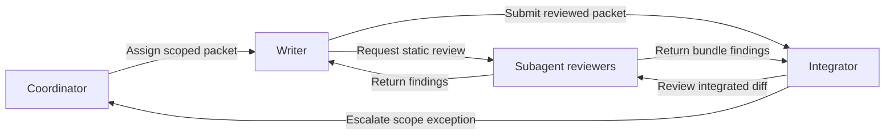

# Reviewed delivery

Workflow example-delivery / 1.0.0 / SHA-256 76393f0ced863b55ffe46f7e52e10c80fd5d082a717483de2b394b24618a2cf9

Generated from workflow.json. Edit the workflow in Fleet Studio, then review and deploy a new release.

This deployed workflow replaces the workflow rules in its historical source documents. References below to former roles, backlog and handoff documents identify migration sources; the definitions in this release control workflow behavior. Continue following applicable engineering standards, source/publication restrictions and explicit ticket/host stops. Report conflicts before acting.

A supervised workflow for bounded implementation, review and delivery.

Prose guards and ticket transitions are agent responsibilities. Studio evaluates only the configured event, session-condition and timer triggers; a notification is not technical acceptance.

## Role: Coordinator [coordinator]

Kind: agent

Goal: Keep every writer on the most valuable ready ticket, with nothing blocked for long.

Set bounded work, assign owners and resolve blockers.

Authority: Own scope and assignments.

## Role: Writer [writer]

Kind: agent

Goal: Turn assigned tickets into small, tested, reviewed changes.

Implement assigned work, verify it and resolve review findings.

Authority: Own only assigned files and scope.

## Role: Subagent reviewers [subagent-reviewers]

Kind: subagent

Review changes independently and return concrete findings.

Authority: Read-only review; implementation stays with the parent.

## Role: Integrator [integrator]

Kind: agent

Goal: Merge reviewed work quickly without breaking the main branch.

Integrate reviewed work and complete delivery.

Authority: Own assigned integration and delivery.

## Handoffs

### Assign scoped packet [assign-scoped-packet]

Coordinator -> Writer

When: An eligible, unclaimed packet is ready

Artifact: Ticket with source, file scope and unit acceptance

Required guard: One writer per owned file

### Request static review [request-static-review]

Writer -> Subagent reviewers

When: Implementation, tests and drafts are ready

Artifact: Exact diff, source basis, tests and draft documentation

Required guard: Read-only reviewers; no independent execution

### Return findings [return-findings]

Subagent reviewers -> Writer

When: Independent review is complete

Artifact: Concrete findings and coverage gaps

Required guard: Writer fixes findings and renews affected evidence

### Submit reviewed packet [submit-reviewed-packet]

Writer -> Integrator

When: Reviewed packet is AI Awaiting Merge

Artifact: Exact head, test and analysis evidence and usable drafts

Required guard: Integrator checks evidence and records bundle ownership

### Review integrated diff [review-integrated-diff]

Integrator -> Subagent reviewers

When: Substantive bundle changes are ready

Artifact: Integrated diff and evidence applicability

Required guard: Read-only; reuse valid completed review

### Return bundle findings [return-bundle-findings]

Subagent reviewers -> Integrator

When: Integration review is complete

Artifact: Findings, corrections and remaining limits

Required guard: Integrator renews checks invalidated by changes

### Escalate scope exception [escalate-scope-exception]

Integrator -> Coordinator

When: A cross-bundle or acceptance exception remains

Artifact: Concrete conflict, evidence and requested decision

Required guard: Ordinary acceptance and merge remain with Integrator

## Ticket states (first matching rule wins)

- closed: Closed; queue roles: ; closed / labels  / prefixes
- blocked: Blocked; queue roles: coordinator; opened / labels AI Blocked / prefixes
- integration: Awaiting merge; queue roles: integrator; opened / labels AI Awaiting Merge / prefixes
- active: In progress; queue roles: writer; opened / labels AI Claimed / prefixes
- ready: Ready; queue roles: writer; opened / labels AI Ready / prefixes
- backlog: Backlog; queue roles: coordinator; fallback

## Ticket transitions

## Agent policies

### Meaningful progress reports [progress-reporting]

Studio observes sessions; report only done, blocked, unblocked and hand-offs with workflow_client.py report. Do not post repeated or no-change updates.

## Trigger templates

### Assign scoped packet [assign-scoped-packet]

event; event=handoff-9e32e493; condition=turn-completed; interval=30 minutes; delivery=automatic; recipients=single

Pick up: Assign scoped packet. Take the next concrete step toward your goal.

### Submit reviewed packet [submit-reviewed-packet]

event; event=handoff-8253bbf2; condition=turn-completed; interval=30 minutes; delivery=automatic; recipients=single

Pick up: Submit reviewed packet. Take the next concrete step toward your goal.

### Escalate scope exception [escalate-scope-exception]

event; event=handoff-4709c619; condition=turn-completed; interval=30 minutes; delivery=automatic; recipients=single

Pick up: Escalate scope exception. Take the next concrete step toward your goal.

## Mapping gaps

## Sources

## Design diagram

